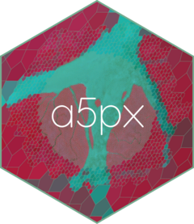

<!-- README.md is generated from README.Rmd. Please edit that file -->

```{r, include = FALSE}
knitr::opts_chunk$set(
  collapse = TRUE,
  comment = "#>",
  fig.path = "man/figures/README-",
  fig.width = 7,
  fig.height = 6,
  dpi = 110,
  dev.args = list(bg = "white"),
  out.width = "100%"
)
```

# a5px <a href="https://belian-earth.github.io/a5px/"></a>

<!-- badges: start -->
[](https://lifecycle.r-lib.org/articles/stages.html#experimental)
[](https://www.apache.org/licenses/LICENSE-2.0)
[](https://github.com/belian-earth/a5px/actions/workflows/R-CMD-check.yaml)
[](https://app.codecov.io/gh/belian-earth/a5px)
[](https://extendr.github.io/extendr/extendr_api/)
<!-- badges: end -->

a5px aggregates raster pixels into [A5](https://a5geo.org/) cells. A5 is
a discrete global grid system (DGGS): it divides the globe into
equal-area pentagonal cells at 31 resolutions. a5px streams GeoTIFF and
Cloud-Optimised GeoTIFF (COG) files from local disk or cloud object
stores and computes per-cell statistics in a single pass, in Rust.

Results are a tibble, an Arrow table or a Parquet file keyed by
`a5R::a5_cell`. On a 12-band Sentinel-2 COG, a5px is about 7 times
faster end to end than `gdal raster zonal-stats` and 11 times faster
than a `terra` and `dplyr` pipeline.

## Installation

a5px is not on CRAN. Install the development version from GitHub:

``` r
# install.packages("pak")
pak::pak("belian-earth/a5px")
```

Building from source needs a [Rust toolchain](https://rustup.rs/) with
`rustc` 1.89 or later. pak also installs
[a5R](https://github.com/belian-earth/a5R), which provides the cell
type. The examples below plot with
[a5view](https://github.com/belian-earth/a5view):

``` r
pak::pak("belian-earth/a5view")
```

## Example

[Earth Genome](https://source.coop/earthgenome/sentinel2-temporal-mosaics)
publishes annual cloud-free Sentinel-2 mosaics as one COG per band. This
reads the red, green and blue bands of a 2023 tile over the fjords of
south Greenland into resolution-14 cells, about 360 m across.
`separate = TRUE` makes each file a column, named after the file, and
the three files share one fetch queue. With the default `stat = "mean"`,
a5px reads the coarsest COG overview that still has several pixels per
cell, rather than every 10 m pixel.

```{r read, message = FALSE}
library(a5px)

tile <- paste0(
  "https://data.source.coop/earthgenome/sentinel2-temporal-mosaics/",
  "23VMH_2023-01-01_2024-01-01/"
)
rgb <- paste0(tile, c("B04", "B03", "B02"), ".tif") # red, green, blue

fjords <- a5_read_raster(rgb, resolution = 14L, separate = TRUE)
fjords
```

a5view's `geom_a5()` draws the cells as a ggplot2 layer, and
`cells_rgb()` turns the three bands into a true-colour composite. The
`range` sets the reflectance values (scaled by 10,000) that map to black
and full brightness.

```{r fjords}
library(ggplot2)
library(a5view)

ggplot(fjords, aes(cell = cell, fill = cells_rgb(B04, B03, B02, range = c(0, 4500)))) +
  geom_a5() +
  theme_void()
```

`bbox` reads a subset. Here a glacier meets the fjord at resolution 15,
about 180 m across, with outlines to show the pentagonal cells:

```{r glacier}
glacier <- a5_read_raster(
  rgb, resolution = 15L, bbox = c(-45.36, 61.11, -45.14, 61.21), separate = TRUE
)

ggplot(glacier, aes(cell = cell, fill = cells_rgb(B04, B03, B02, range = c(0, 4500)))) +
  geom_a5(colour = "white", linewidth = 0.05) +
  theme_void()
```

## What else it does

- **Three outputs** from one engine: a tibble (`a5_read_raster()`), an
  Arrow table (`a5_read_raster_arrow()`) or a Parquet file written
  straight from Rust (`a5_raster_to_parquet()`).
- **Statistics** in one pass: mean, sum, count, min, max, variance,
  standard deviation, majority class and class fractions.
- **Sampling modes**: pixel centres (the default), area-weighted overlay
  that conserves sums, or centroid sampling for cells finer than pixels.
- **Subsets** by bounding box or polygon, and chunked reads that fetch
  each COG block once.
- **Several files** in one read: bands stored one per file, tiles pooled
  into one product, or captures composited per cell.
- **Decoding** of scale and offset, or of quantized codes such as Alpha
  Earth Foundations embeddings, before aggregation.
- **Cloud sources** on S3, GCS, Azure and HTTP(S), configured from the
  environment, with a session cache of the byte ranges fetched.

[Getting started](https://belian-earth.github.io/a5px/articles/a5px.html) covers each of these with examples, and the
[reference](https://belian-earth.github.io/a5px/reference/) documents
every argument.

## Acknowledgements

Built on the [a5 Rust crate](https://github.com/felixpalmer/a5-rs) by
[Felix Palmer](https://github.com/felixpalmer) and on
[a5R](https://github.com/belian-earth/a5R) for the cell type and Arrow
interop. Streaming I/O and TIFF parsing come from the
[`async-tiff`](https://github.com/developmentseed/async-tiff) team at
Development Seed, with
[`object_store`](https://crates.io/crates/object_store) for cloud reads,
[`proj4rs`](https://crates.io/crates/proj4rs) for reprojection and
[`extendr`](https://extendr.github.io/extendr/extendr_api/) for the R
bindings.
