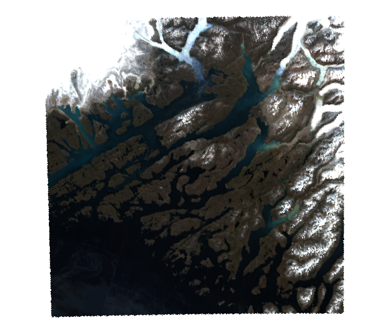
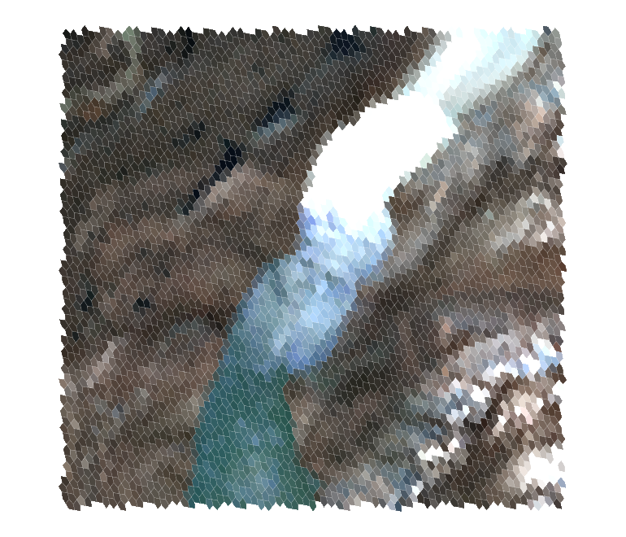

<!-- README.md is generated from README.Rmd. Please edit that file -->

# a5px

<!-- badges: start -->

[](https://lifecycle.r-lib.org/articles/stages.html#experimental)
[](https://www.apache.org/licenses/LICENSE-2.0)
[](https://github.com/belian-earth/a5px/actions/workflows/R-CMD-check.yaml)
[](https://app.codecov.io/gh/belian-earth/a5px)
[](https://extendr.github.io/extendr/extendr_api/)
<!-- badges: end -->

a5px aggregates raster pixels into [A5](https://a5geo.org/) cells. A5 is
a discrete global grid system (DGGS): it divides the globe into
equal-area pentagonal cells at 31 resolutions. a5px streams GeoTIFF and
Cloud-Optimised GeoTIFF (COG) files from local disk or cloud object
stores and computes per-cell statistics in a single pass, in Rust.

Results are a tibble, an Arrow table or a Parquet file keyed by
`a5R::a5_cell`. On a 12-band Sentinel-2 COG, a5px is about 7 times
faster end to end than `gdal raster zonal-stats` and 11 times faster
than a `terra` and `dplyr` pipeline.

## Installation

a5px is not on CRAN. Install the development version from GitHub:

``` r
# install.packages("pak")
pak::pak("belian-earth/a5px")
```

Building from source needs a [Rust toolchain](https://rustup.rs/) with
`rustc` 1.85 or later. pak also installs
[a5R](https://github.com/belian-earth/a5R), which provides the cell
type. The examples below plot with
[a5view](https://github.com/belian-earth/a5view):

``` r
pak::pak("belian-earth/a5view")
```

## Example

[Earth
Genome](https://source.coop/earthgenome/sentinel2-temporal-mosaics)
publishes annual cloud-free Sentinel-2 mosaics as one COG per band. This
reads the red, green and blue bands of a 2023 tile over the fjords of
south Greenland into resolution-14 cells, about 360 m across. With the
default `stat = "mean"`, a5px reads the coarsest COG overview that still
has several pixels per cell, rather than every 10 m pixel.

``` r
library(a5px)

tile <- paste0(
  "https://data.source.coop/earthgenome/sentinel2-temporal-mosaics/",
  "23VMH_2023-01-01_2024-01-01/"
)

# Read one band per file and name its column after the band
read_band <- function(band, ...) {
  cells <- a5_read_raster(paste0(tile, band, ".tif"), ...)
  setNames(cells, c("cell", band))
}

rgb <- c("B04", "B03", "B02") # red, green, blue
fjords <- Reduce(merge, lapply(rgb, read_band, resolution = 14L))
tibble::as_tibble(fjords)
#> # A tibble: 95,875 × 4
#>    cell               B04   B03   B02
#>    <a5_cell>        <dbl> <dbl> <dbl>
#>  1 0da0531580000000  298.  416.  537.
#>  2 0da053bf80000000  269.  359.  458.
#>  3 0da053c080000000  274.  382.  510.
#>  4 0da053c180000000  319   434   519 
#>  5 0da053c280000000  302.  422.  563.
#>  6 0da053c380000000  293.  406.  525.
#>  7 0da053c480000000  304.  410.  517.
#>  8 0da053c580000000  306.  421.  540.
#>  9 0da053c680000000  306.  416.  535.
#> 10 0da053c780000000  298.  399.  502.
#> # ℹ 95,865 more rows
```

a5view’s `geom_a5()` draws the cells as a ggplot2 layer, and
`cells_rgb()` turns the three bands into a true-colour composite. The
`range` sets the reflectance values (scaled by 10,000) that map to black
and full brightness.

``` r
library(ggplot2)
library(a5view)

ggplot(fjords, aes(cell = cell, fill = cells_rgb(B04, B03, B02, range = c(0, 4500)))) +
  geom_a5() +
  theme_void()
```



`bbox` reads a subset. Here a glacier meets the fjord at resolution 15,
about 180 m across, with outlines to show the pentagonal cells:

``` r
glacier <- Reduce(merge, lapply(
  rgb, read_band,
  resolution = 15L, bbox = c(-45.36, 61.11, -45.14, 61.21)
))

ggplot(glacier, aes(cell = cell, fill = cells_rgb(B04, B03, B02, range = c(0, 4500)))) +
  geom_a5(colour = "white", linewidth = 0.05) +
  theme_void()
```



## Usage

### Readers

Three readers share one engine and differ only in what they return:

``` r
# tibble: one numeric column per band
tbl <- a5_read_raster(src, resolution, stat, bands)

# Arrow table: a cell column and a FixedSizeList<float, n_bands> per stat
arr <- a5_read_raster_arrow(src, resolution, stat, bands, value_type = "float64")

# Parquet written directly from Rust, with no R-side Arrow round trip
a5_raster_to_parquet(src, dest, resolution, stat, bands, value_type, compression)

# write a tibble or Arrow table from the first two
a5_write_parquet(x, dest, compression = "zstd")

# metadata without reading pixels
a5_raster_info(src)   # dimensions, data type, block grid, overviews, CRS, envelope
a5_store_config(src)  # resolved object store configuration for a remote src
```

Their main arguments:

- `src`: a path or URL: local, `file://`, `http(s)://`, `s3://`, `gs://`
  or `az://`. Remote reads fetch byte ranges and never download the
  whole file.
- `resolution`: A5 resolution, 0 to 30. `a5R::a5_cell_area()` gives the
  cell area at each.
- `stat`: one or more of `"mean"`, `"sum"`, `"count"`, `"min"`, `"max"`,
  `"var"`, `"sd"`, `"majority"` and `"fractions"`. With several, the
  tibble has one column per band and stat, and the Arrow and Parquet
  outputs one list column per stat.
- `bands`: `NULL` (all), 1-based indices, or names matched against the
  GDAL `DESCRIPTION` band tag.
- `bbox`, `bbox_align`: a WGS 84 subset, by pixel or by whole COG block
  (see [Chunked reads](#chunked-reads)).
- `aoi`, `containment`: keep only the A5 cells of a polygon (see [Areas
  of interest](#areas-of-interest)).
- `mode`: `"forward"`, `"overlay"` or `"centroid"` sampling.
- `scoff`, `dequant`: decode stored values per pixel before aggregation
  (see [Decoding stored values](#decoding-stored-values)).
- `use_overviews`: whether `stat = "mean"` may read a COG overview.
- `cpu_workers`, `io_concurrency`: tile-level concurrency.
- `store_opts`: object store options (see [Remote
  sources](#remote-sources)).

### Several statistics in one pass

``` r
# sum and count let you merge partial results without re-reading
agg <- a5_read_raster(src, resolution = 14L, stat = c("mean", "sum", "count"))
# columns: cell, B02_mean, B02_sum, B02_count, B03_mean, ...
```

### Coarser resolutions

`a5_aggregate()` summarises a result at a coarser resolution without
re-reading the raster. Each cell goes to the coarse cell that contains
its centre:

``` r
coarse <- a5_aggregate(fine, to_resolution = 10L)
```

### Decoding stored values

`scoff = TRUE` applies the scale and offset each band declares (see
`a5_raster_info()`), for example to turn integer reflectance into
physical units. The decode is linear, so it can run before or after
averaging with the same result.

Quantized sources are different. A nonlinear decode does not commute
with the mean, so averaging raw codes and decoding the result gives the
wrong answer. `dequant` decodes each pixel in Rust before aggregation:

``` r
# Alpha Earth Foundations int8 codes: sign(x) * (x / 127.5)^2
emb <- a5_read_raster(url, resolution = 14L, bands = 1:8, dequant = dequant_aef)

# or any vectorised R function over the integer codes
emb <- a5_read_raster(url, resolution = 14L, dequant = function(x) x / 250)
```

Any R function works because the codes are a finite set: a5px evaluates
the function once per possible code and passes Rust a lookup table. So
`dequant` needs an integer source of 16 bits or fewer (int8, uint8,
int16 or uint16). NoData is matched against the raw code.

Setting `dequant` also turns `use_overviews` off by default. COG
overviews are usually built by averaging, and an average of codes
decodes wrongly. Set `use_overviews = TRUE` (it warns) only when the
overviews were built with nearest or mode resampling.

### Overlay sampling

The default forward mode assigns each pixel to the cell containing its
centre. `mode = "overlay"` instead splits each pixel between the cells
it overlaps, in proportion to area, estimated by supersampling each
pixel (`subsamples`, chosen automatically by default):

``` r
# area-weighted mean: boundary pixels are shared, not all-or-nothing
a5_read_raster(src, resolution = 12L, mode = "overlay")

# mass-preserving sum: totals such as population counts are conserved
a5_read_raster(src, resolution = 12L, mode = "overlay", stat = "sum")
```

Pixels wholly inside one cell cost the same as in forward mode; only
pixels on a cell boundary are supersampled.

### Categorical rasters

For integer class labels such as land cover, `stat = "majority"` gives
each cell’s dominant class and `stat = "fractions"` the share of each
class as a list column. Under `mode = "overlay"` both are area-weighted:

``` r
a5_read_raster(landcover, resolution = 12L, stat = "majority", mode = "overlay")
a5_read_raster(landcover, resolution = 12L, stat = "fractions")
```

### Cells finer than pixels

When cells are smaller than pixels, `mode = "centroid"` samples one
value at each cell centre. `interp` picks the kernel: `"nearest"`
(default), `"bilinear"`, `"bicubic"` (Keys) or `"lanczos"`.

``` r
a5_read_raster(dem, resolution = 18L, mode = "centroid", interp = "bilinear")
```

### Band selection

For COGs that store each band separately (`INTERLEAVE=BAND`), common for
embedding rasters such as Alpha Earth Foundations, `bands` limits the
download to the selected bands. Reading 8 of 64 bands from a 2.8 GB AEF
tile takes 24 s instead of 62 s.

``` r
a5_raster_to_parquet(
  url, "embeddings.parquet",
  resolution     = 14L,
  bands          = 1:8,
  value_type     = "float32",
  compression    = "zstd",
  cpu_workers    = 16L,
  io_concurrency = 16L
)
```

### Remote sources

Cloud clients take their configuration from the environment first (every
`AWS_*`, `GOOGLE_*` and `AZURE_*` variable that `object_store`
understands, plus GDAL’s `AWS_NO_SIGN_REQUEST=YES` for public buckets)
and from `store_opts` second, so an explicit option always wins.

``` r
# public bucket outside us-east-1, no credentials
Sys.setenv(AWS_NO_SIGN_REQUEST = "YES", AWS_REGION = "us-west-2")
a5_read_raster("s3://us-west-2.opendata.source.coop/tge-labs/aef/.../tile.tiff", 14L)

# the same without touching the environment
a5_read_raster(src, 14L, store_opts = c(aws_region = "us-west-2",
                                        aws_skip_signature = "true"))

# check region, endpoint and signing before a long read
a5_store_config(src, store_opts = c(aws_region = "us-west-2"))
```

a5px does not read the shared credentials file or `AWS_PROFILE`. Without
credentials or `aws_skip_signature`, the client falls back to instance
metadata, which off AWS waits for a long timeout before failing.

### Areas of interest

`aoi` restricts a read to the A5 cells of a polygon, selected as by
`a5R::a5_polygon_to_cells()`: `containment = "centre"` keeps cells whose
centre is inside and `"overlapping"` every cell the polygon touches.
Selection is by cell: an included cell gets the statistics of all its
valid pixels, including any outside the polygon.

``` r
a5_read_raster(src, 14L, aoi = sf::st_geometry(catchment), containment = "overlapping")

# centroid mode samples the AOI cells directly, covering the polygon without gaps
a5_read_raster(dem, 18L, mode = "centroid", aoi = catchment, containment = "overlapping")
```

### Chunked reads

The accumulators hold every touched cell in memory, so split very large
reads by `bbox`. `bbox_align = "block"` takes the COG blocks whose
origin lies in the bbox, so a partition of bboxes fetches every block
exactly once and per-cell `sum` and `count` partials add up exactly.

``` r
info <- a5_raster_info(src)           # block grid and WGS 84 envelope
chunks <- split_bbox(info$bbox, 4, 4) # your own grid over info$bbox
parts <- lapply(chunks, function(b) {
  a5_read_raster(src, 18L, bbox = b, bbox_align = "block",
                 stat = c("sum", "count"), use_overviews = FALSE)
})
```

### Configuration

``` r
a5px_set_concurrency(cpu_workers = 8, io_concurrency = 16) # session default
a5px_get_concurrency()                                     # current setting
Sys.setenv(A5PX_PROFILE = "1")                             # stage timings to stderr
```

## Supported

- **Formats**: tiled GeoTIFF and COG with ZSTD, Deflate, LZW, JPEG or no
  compression, from local files or S3, GCS, Azure and HTTP(S) stores.
- **Coordinate reference systems**: EPSG codes, WKT in citation fields,
  and reconstruction from GeoKey parameters. Custom projections written
  by GDAL without an EPSG code, such as a centred Lambert azimuthal
  equal-area (`+proj=laea +lon_0=... +lat_0=...`), Albers, Lambert
  conformal conic or polar stereographic, are recognised.
- **NoData**: the dataset-wide `TIFFTAG_GDAL_NODATA`, compared safely
  for NaN.

## Not yet supported

- Strip-based GeoTIFFs. They fail with a clear error.
- Per-band NoData. GeoTIFF does not store it; it will come with VRT
  support.
- Rasters that cross the antimeridian.

## Stack

- [`async-tiff`](https://crates.io/crates/async-tiff) and
  [`object_store`](https://crates.io/crates/object_store) for streamed
  reads.
- [`proj4rs`](https://crates.io/crates/proj4rs) for pure-Rust
  reprojection, and [`proj4wkt`](https://crates.io/crates/proj4wkt) for
  CRSs given only as WKT.
- [`a5`](https://crates.io/crates/a5) for cell maths.
- [`arrow-array`](https://crates.io/crates/arrow-array) and
  [`parquet`](https://crates.io/crates/parquet) for the Parquet writer.
- [`extendr-api`](https://extendr.github.io/extendr/extendr_api/) for
  the R bindings.

## Acknowledgements

Built on the [a5 Rust crate](https://github.com/felixpalmer/a5-rs) by
[Felix Palmer](https://github.com/felixpalmer) and on
[a5R](https://github.com/belian-earth/a5R) for the cell type and Arrow
interop. Streaming I/O and TIFF parsing come from the
[`async-tiff`](https://github.com/developmentseed/async-tiff) team at
Development Seed.
