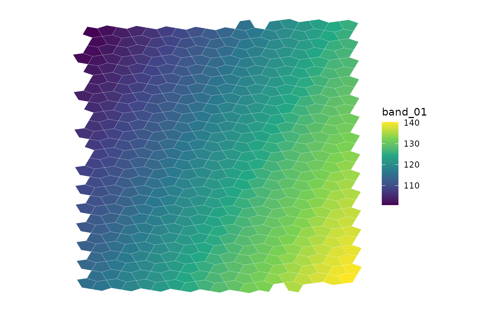
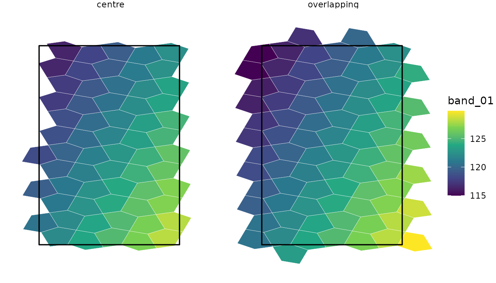
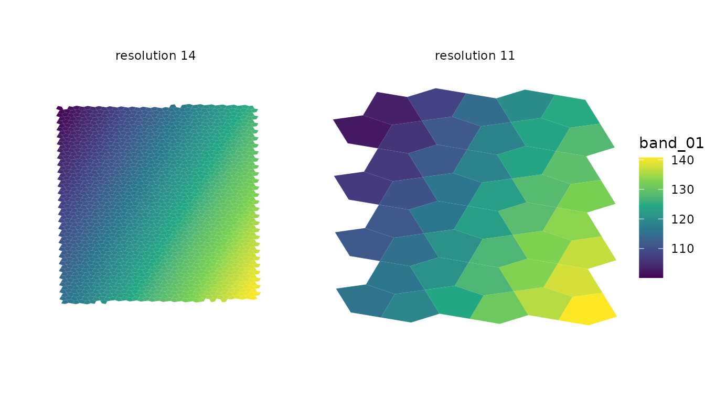

# Getting started with a5px

a5px turns raster pixels into statistics over [A5](https://a5geo.org/)
cells, the equal-area pentagons of a discrete global grid. It reads
GeoTIFF and Cloud-Optimised GeoTIFF (COG) files from disk or a cloud
store, assigns each pixel to a cell, and returns one row per cell. This
article walks through the readers and their options. The examples run on
small rasters shipped with the package; those that need the network are
shown but not run.

``` r

library(a5px)
```

## Reading a raster

[`a5_raster_info()`](https://belian-earth.github.io/a5px/reference/a5_raster_info.md)
describes a file without reading its pixels: size, data type, block
grid, overviews, CRS and its envelope in WGS 84.

``` r

cog <- system.file("extdata", "overview_cog.tif", package = "a5px")
info <- a5_raster_info(cog)
info[c("width", "height", "dtype", "crs", "block", "bbox")]
#> $width
#> [1] 512
#> 
#> $height
#> [1] 512
#> 
#> $dtype
#> [1] "float32"
#> 
#> $crs
#> [1] "EPSG:32633"
#> 
#> $block
#> [1] 256 256
#> 
#> $bbox
#> [1] 13.72488 45.14639 13.92331 45.28664
```

[`a5_read_raster()`](https://belian-earth.github.io/a5px/reference/a5_read_raster.md)
aggregates it into cells at one A5 resolution. Each row is a cell, keyed
by an
[`a5R::a5_cell`](https://belian-earth.github.io/a5R/reference/a5_cell.html),
with one column per band:

``` r

cells <- a5_read_raster(cog, resolution = 13L)
cells
#> # A tibble: 516 × 2
#>    cell             band_01
#>    <a5_cell>          <dbl>
#>  1 514456a600000000    138.
#>  2 514456aa00000000    137.
#>  3 514456ae00000000    138.
#>  4 514456b200000000    139.
#>  5 514473c600000000    139.
#>  6 514473e600000000    140.
#>  7 514473ea00000000    140.
#>  8 514473ee00000000    139.
#>  9 514473f200000000    138.
#> 10 514473f600000000    139.
#> # ℹ 506 more rows
```

[a5view](https://github.com/belian-earth/a5view) draws the cells as a
ggplot2 layer,
[`geom_a5()`](https://belian-earth.github.io/a5view/reference/geom_a5.html),
which takes the cell column as its `cell` aesthetic:

``` r

library(ggplot2)
library(a5view)

ggplot(cells, aes(cell = cell, fill = band_01)) +
  geom_a5(colour = "white", linewidth = 0.05) +
  scale_fill_viridis_c() +
  theme_void()
```



The resolution sets the cell size.
[`a5R::a5_cell_area()`](https://belian-earth.github.io/a5R/reference/a5_resolution_stats.html)
gives the area in square metres: a resolution-13 cell, about 0.5 km^2,
holds some 560 of this raster’s 30 m pixels.

``` r

a5R::a5_cell_area(c(10L, 13L, 16L, 18L))
#> Units: [m^2]
#> [1] 3.242910e+07 5.067047e+05 7.917261e+03 4.948288e+02
```

Resolutions run from 0 to 29. Resolution 30 is refused for now: the a5
crate returns resolution-29 cells for some points at 30.

### Three outputs

The three readers share one engine and differ in what they return:

- [`a5_read_raster()`](https://belian-earth.github.io/a5px/reference/a5_read_raster.md)
  returns a tibble, one numeric column per band and statistic.
- [`a5_read_raster_arrow()`](https://belian-earth.github.io/a5px/reference/a5_read_raster_arrow.md)
  returns an Arrow table, with the same columns or, with
  `as_vector = TRUE`, one list column per statistic holding every band.
- [`a5_raster_to_parquet()`](https://belian-earth.github.io/a5px/reference/a5_raster_to_parquet.md)
  writes a Parquet file straight from Rust, which avoids holding the
  result in R.

``` r

tab <- a5_read_raster_arrow(cog, resolution = 13L)
tab
#> Table
#> 516 rows x 2 columns
#> $cell <uint64>
#> $band_01 <double>
#> 
#> See $metadata for additional Schema metadata

pq <- tempfile(fileext = ".parquet")
a5_raster_to_parquet(cog, pq, resolution = 13L, compression = "zstd")
arrow::read_parquet(pq, as_data_frame = FALSE)
#> Table
#> 516 rows x 2 columns
#> $cell <uint64 not null>
#> $band_01 <double not null>
#> 
#> See $metadata for additional Schema metadata
```

[`a5px_write_parquet()`](https://belian-earth.github.io/a5px/reference/a5px_write_parquet.md)
writes a tibble or Arrow table from the first two. The Arrow and Parquet
outputs record the read’s provenance in their metadata: the A5 index
version, the a5 crate and a5px versions, the sampling mode, the decode,
whether overviews were allowed and any nodata override.

## Statistics

`stat` takes one or more of `"mean"`, `"sum"`, `"count"`, `"min"`,
`"max"`, `"var"`, `"sd"`, `"majority"` and `"fractions"`, all computed
in one pass. `"npix"` adds the number of pixels in each cell with any
valid band.

``` r

a5_read_raster(cog, resolution = 13L, stat = c("mean", "sd", "count", "npix"))
#> # A tibble: 524 × 5
#>    cell             band_01_mean band_01_sd band_01_count  npix
#>    <a5_cell>               <dbl>      <dbl>         <dbl> <dbl>
#>  1 514456a600000000         138.      0.225           113   113
#>  2 514456aa00000000         137.      0.454           560   560
#>  3 514456ae00000000         138.      0.307           313   313
#>  4 514456b200000000         139.      0.224           112   112
#>  5 514473c600000000         139.      0.466           438   438
#>  6 514473e600000000         140.      0.219           110   110
#>  7 514473ea00000000         140.      0.292           283   283
#>  8 514473ee00000000         139.      0.454           564   564
#>  9 514473f200000000         138.      0.502           560   560
#> 10 514473f600000000         139.      0.306           312   312
#> # ℹ 514 more rows
```

`sum` and `count` let partial results be merged without re-reading the
raster, as in [chunked reads](#chunked-reads).

For integer class labels such as land cover, `"majority"` gives each
cell’s most common class and `"fractions"` the share of each class, as a
list column:

``` r

a5_read_raster(landcover, resolution = 12L, stat = c("majority", "fractions"))
```

Pixels equal to the file’s nodata value, and NaN pixels, are missing:
they enter no statistic. `src_nodata` overrides the file’s value.

## Sampling modes

`mode` controls how pixels map to cells.

- `"forward"` (the default) assigns each pixel to the cell that contains
  its centre. It suits cells several pixels across.
- `"overlay"` splits each pixel between the cells it overlaps, in
  proportion to area, estimated by supersampling the pixel
  (`subsamples`). Means become area-weighted and `sum` conserves totals,
  such as population counts. Only pixels on a cell boundary pay for the
  supersampling.
- `"centroid"` samples the raster at each cell’s centre, for cells
  smaller than pixels. `interp` picks the kernel: `"nearest"` (the
  default), `"bilinear"`, `"bicubic"` or `"lanczos"`.

``` r

a5_read_raster(cog, resolution = 11L, mode = "overlay", stat = c("mean", "sum"))
#> # A tibble: 44 × 3
#>    cell             band_01_mean band_01_sum
#>    <a5_cell>               <dbl>       <dbl>
#>  1 514456a000000000         137.     206570.
#>  2 514473a000000000         141.       1690.
#>  3 514473e000000000         138.     646628.
#>  4 5144742000000000         136.     438124.
#>  5 514474e000000000         131.     184203.
#>  6 5145082000000000         107.     755635.
#>  7 5145086000000000         111.     991566.
#>  8 514508a000000000         116.    1046736.
#>  9 514508e000000000         111.     790444.
#> 10 5145092000000000         111.     115632.
#> # ℹ 34 more rows
a5_read_raster(cog, resolution = 18L, mode = "centroid", interp = "bilinear",
               bbox = c(13.80, 45.20, 13.81, 45.21))
#> # A tibble: 1,766 × 2
#>    cell             band_01
#>    <a5_cell>          <dbl>
#>  1 5145089800800000    119.
#>  2 5145089802800000    118.
#>  3 5145089803800000    118.
#>  4 5145089806800000    118.
#>  5 5145089808800000    118.
#>  6 5145089809800000    118.
#>  7 514508980a800000    118.
#>  8 514508980b800000    118.
#>  9 514508980c800000    118.
#> 10 514508980d800000    118.
#> # ℹ 1,756 more rows
```

Under `"overlay"`, `majority` and `fractions` are area-weighted too.

### Overviews

With `stat = "mean"` in forward or overlay mode, a5px reads the coarsest
COG overview that still has several pixels per cell, which cuts the
download for coarse resolutions. Other statistics, such as `sum`,
`count` or `max`, always read full-resolution pixels, since an overview
changes them. `use_overviews = FALSE` turns this off.

## Subsets

### Bounding box

`bbox` reads only the pixels inside a WGS 84 box,
`c(xmin, ymin, xmax, ymax)`. A box with `xmin > xmax` crosses the
antimeridian.

``` r

b <- info$bbox
west <- c(b[1], b[2], (b[1] + b[3]) / 2, b[4])
a5_read_raster(cog, resolution = 13L, bbox = west)
#> # A tibble: 270 × 2
#>    cell             band_01
#>    <a5_cell>          <dbl>
#>  1 5145080200000000    104.
#>  2 5145080600000000    105.
#>  3 5145080a00000000    106.
#>  4 5145080e00000000    105.
#>  5 5145081200000000    106.
#>  6 5145081600000000    107.
#>  7 5145081a00000000    107.
#>  8 5145081e00000000    108.
#>  9 5145082200000000    109.
#> 10 5145082600000000    110.
#> # ℹ 260 more rows
```

### Areas of interest

`aoi` keeps the A5 cells of a polygon, selected as by
[`a5R::a5_polygon_to_cells()`](https://belian-earth.github.io/a5R/reference/a5_polygon_to_cells.html):
`containment = "centre"` keeps the cells whose centre is inside,
`"overlapping"` every cell the polygon touches. Selection is by cell, so
an included cell gets all its valid pixels, including any outside the
polygon. `aoi` takes what
[`a5R::a5_polygon_to_cells()`](https://belian-earth.github.io/a5R/reference/a5_polygon_to_cells.html)
does: `sf` or `sfc` objects, `wk` geometries, WKT, a terra `SpatVector`
or a lon/lat matrix.

``` r

aoi <- wk::rct(13.80, 45.18, 13.86, 45.24, crs = wk::wk_crs_longlat())
a5_read_raster(cog, resolution = 13L, aoi = aoi, containment = "overlapping")
#> # A tibble: 81 × 2
#>    cell             band_01
#>    <a5_cell>          <dbl>
#>  1 5145088e00000000    116.
#>  2 5145089200000000    117.
#>  3 5145089600000000    119.
#>  4 5145089a00000000    117.
#>  5 51450e6e00000000    121.
#>  6 51450e8200000000    123.
#>  7 51450e8600000000    122.
#>  8 51450e8a00000000    121.
#>  9 51450e8e00000000    122.
#> 10 51450e9200000000    121.
#> # ℹ 71 more rows
```

The two rules side by side, with the AOI outlined. `"overlapping"` adds
the cells the edge cuts, and each keeps its pixels outside the polygon:

``` r

by_rule <- lapply(c("centre", "overlapping"), function(rule) {
  out <- a5_read_raster(cog, resolution = 13L, aoi = aoi, containment = rule)
  out$containment <- rule
  out
})
ggplot(vctrs::vec_rbind(!!!by_rule)) +
  geom_a5(aes(cell = cell, fill = band_01), colour = "white", linewidth = 0.1) +
  geom_sf(data = sf::st_as_sf(aoi), fill = NA, colour = "black", linewidth = 0.6) +
  facet_wrap(~containment) +
  scale_fill_viridis_c() +
  theme_void()
```



In centroid mode the AOI’s cells are sampled directly, so the polygon is
covered without gaps.

### Chunked reads

A read holds every cell it touches in memory until it finishes, so very
large reads are best split by `bbox`. `bbox_align = "block"` takes the
COG blocks whose origin lies in each box, so a set of boxes that tiles
the raster fetches every block once, and `sum` and `count` add up
exactly across chunks:

``` r

east <- c((b[1] + b[3]) / 2, b[2], b[3], b[4])
parts <- lapply(list(west, east), function(bb) {
  a5_read_raster(cog, resolution = 13L, bbox = bb, bbox_align = "block",
                 stat = c("sum", "count"), use_overviews = FALSE)
})
whole <- a5_read_raster(cog, resolution = 13L, stat = c("sum", "count"),
                        use_overviews = FALSE)
c(chunked = sum(sapply(parts, function(p) sum(p[[3]]))), whole = sum(whole[[3]]))
#> chunked   whole 
#>  262144  262144
```

Remote chunks reuse the header and blocks they share through a session
cache (see [Remote sources](#remote-sources)).

## Several files

`src` takes several files, read in one pass. How they combine depends on
what they hold:

``` r

# bands stored one file each: one column per file, named by names(src)
a5_read_raster(c(red = red_url, nir = nir_url), 14L, separate = TRUE)

# adjacent tiles, or repeat captures, of one product: pixels pooled
a5_read_raster(c(tile_a, tile_b), 14L)

# a statistic per capture, then reduced across captures in each cell
a5_read_raster(captures, 14L, composite = "median")
a5_read_raster(captures, 14L, composite = "count") # captures per cell
```

Pooled files must have the same bands and pixel size. Every valid pixel
enters its cell once, so cells on a seam between tiles combine exactly,
and where files overlap every capture counts. `composite` computes
`stat` for each file and reduces across files, weighting each by its
valid pixels in the cell. Single-band files without band descriptions
look alike to the pooling check, so set `separate = TRUE` for files that
hold different bands.

## Decoding stored values

`scoff = TRUE` applies the scale and offset each band declares, turning
stored integers into physical units:

``` r

sc <- system.file("extdata", "scoff_int16.tif", package = "a5px")
a5_raster_info(sc)[c("scale", "offset")]
#> $scale
#> [1] 0.01 0.50
#> 
#> $offset
#> [1]  0 10
a5_read_raster(sc, resolution = 12L, scoff = TRUE)
#> # A tibble: 136 × 3
#>    cell              rh98 band_02
#>    <a5_cell>        <dbl>   <dbl>
#>  1 514eaab800000000  5.00  -231. 
#>  2 514eaac800000000  4.26  -194. 
#>  3 514eaaf800000000  3.50  -157. 
#>  4 514eab0800000000  2.75  -118. 
#>  5 514eab3800000000  1.99   -80.7
#>  6 514eabe800000000  1.24   -43  
#>  7 6ab3f20800000000  4.97   495  
#>  8 6ab3f21800000000  5.38   489. 
#>  9 6ab3f23800000000  5.63   462. 
#> 10 6ab3f24800000000  6.13   452. 
#> # ℹ 126 more rows
```

A linear decode gives the same result before or after averaging. A
quantized code does not: the mean of codes is not the code of the mean.
`dequant` decodes each pixel before it enters the statistics. It takes
any vectorised R function of the integer codes; a5px evaluates it once
per possible code and passes the table to Rust, so the source must be an
integer type of 16 bits or fewer. `dequant_aef` decodes Alpha Earth
Foundations embeddings, `sign(x) * (x / 127.5)^2`:

``` r

aef <- system.file("extdata", "aef_int8.tif", package = "a5px")
a5_read_raster(aef, resolution = 13L, dequant = dequant_aef)
#> # A tibble: 194 × 3
#>    cell                  A01      A02
#>    <a5_cell>           <dbl>    <dbl>
#>  1 5160d62a00000000 -0.632   -0.134  
#>  2 5160d62e00000000 -0.308   -0.190  
#>  3 5160d63200000000 -0.300   -0.0190 
#>  4 5160d63600000000 -0.0223   0.0934 
#>  5 5160d68200000000  0.0554   0.272  
#>  6 5160d68600000000  0.0655  -0.249  
#>  7 5160d68a00000000  0.207   -0.142  
#>  8 5160d68e00000000 -0.00866 -0.359  
#>  9 5160d69200000000 -0.0793   0.303  
#> 10 5160d69600000000 -0.549    0.00855
#> # ℹ 184 more rows
```

A function that returns `NA` for some codes marks those pixels missing.
Setting `dequant` also turns `use_overviews` off, since overviews built
by averaging codes decode wrongly.

## Coarser resolutions

[`a5_aggregate()`](https://belian-earth.github.io/a5px/reference/a5_aggregate.md)
summarises a result at a coarser resolution without re-reading the
raster. Each cell goes to the coarse cell containing its centre, and
means are weighted by each cell’s pixel count:

``` r

fine <- a5_read_raster(cog, resolution = 14L, stat = c("mean", "npix"))
coarse <- a5_aggregate(fine, resolution = 11L)
coarse
#> # A tibble: 44 × 3
#>    cell             band_01  npix
#>    <a5_cell>          <dbl> <dbl>
#>  1 514456a000000000    137.  1282
#>  2 514473a000000000    141.    39
#>  3 514473e000000000    138.  4909
#>  4 5144742000000000    136.  3264
#>  5 514474e000000000    131.  1391
#>  6 5145082000000000    107.  7260
#>  7 5145086000000000    111.  8694
#>  8 514508a000000000    116.  8717
#>  9 514508e000000000    111.  7279
#> 10 5145092000000000    111.  1130
#> # ℹ 34 more rows
```

Coarse cells along the raster’s edge extend past it, and their means
cover only the part with pixels:

``` r

both <- vctrs::vec_rbind(
  tibble::tibble(cell = fine$cell, band_01 = fine$band_01, res = "resolution 14"),
  tibble::tibble(cell = coarse$cell, band_01 = coarse$band_01, res = "resolution 11")
)
both$res <- factor(both$res, levels = c("resolution 14", "resolution 11"))
ggplot(both, aes(cell = cell, fill = band_01)) +
  geom_a5() +
  facet_wrap(~res) +
  scale_fill_viridis_c() +
  theme_void()
```



## Remote sources

`src` may be an `s3://`, `gs://`, `az://` or `http(s)://` URL, or a GDAL
`/vsis3/`, `/vsigs/`, `/vsiaz/` or `/vsicurl/` path. Reads fetch byte
ranges and never download the whole file. Cloud clients are configured
from the environment first, every `AWS_*`, `GOOGLE_*` and `AZURE_*`
variable that `object_store` understands plus GDAL’s
`AWS_NO_SIGN_REQUEST`, and from `store_opts` second, so an explicit
option wins.

``` r

url <- "s3://us-west-2.opendata.source.coop/tge-labs/aef/v1/annual/2020/22S/tile.tiff"

# a public bucket outside us-east-1
a5_read_raster(url, 14L, store_opts = c(aws_region = "us-west-2",
                                        aws_skip_signature = "true"))

# check region, endpoint and signing before a long read
a5px_store_config(url, store_opts = c(aws_region = "us-west-2"))
```

An S3 source with no credentials configured is read unsigned where no
instance metadata service answers, which reads public data. The shared
credentials file and `AWS_PROFILE` are not read. See
[`?a5px`](https://belian-earth.github.io/a5px/reference/a5px-package.md)
for each provider’s settings.

Remote reads keep the byte ranges they fetch in a session cache, so a
read split into chunks, or repeated, fetches each block once.
[`a5px_set_cache()`](https://belian-earth.github.io/a5px/reference/a5px_set_cache.md)
sets its budget (512 MiB, or an eighth of a container memory limit, by
default),
[`a5px_cache_info()`](https://belian-earth.github.io/a5px/reference/a5px_set_cache.md)
reports its size and the requests made, and
[`a5px_clear_cache()`](https://belian-earth.github.io/a5px/reference/a5px_set_cache.md)
empties it.

## Performance

- **Workers and requests.** `cpu_workers` sets the threads that decode
  and index pixels; it defaults to the CPUs available to R, which
  respects container limits. `io_concurrency` sets the remote requests a
  read keeps in flight, 32 by default.
  [`a5px_concurrency()`](https://belian-earth.github.io/a5px/reference/a5px_concurrency.md)
  sets both for the session, or for one expression with
  [`with()`](https://rdrr.io/r/base/with.html).
- **Bands.** For COGs that store each band separately
  (`INTERLEAVE=BAND`), as embedding rasters often do, `bands` limits the
  download to the bands selected: reading 8 of 64 bands of a 2.8 GB AEF
  tile takes 24 s instead of 62 s. `bands` takes 1-based indices or band
  names.
- **Memory.** The cells of a read are held until it finishes: the mean
  of 64 bands over a 2048 x 2048 AEF window, 848,000 cells at resolution
  18, peaks at about 1.1 GB. For larger areas, chunk by `bbox`.
  `value_type = "float32"` halves the size of Arrow and Parquet output.
- **Profiling.** `Sys.setenv(A5PX_PROFILE = "1")` prints the time spent
  in each stage of a read.

``` r

a5_raster_to_parquet(
  url, "embeddings.parquet",
  resolution = 14L, bands = 1:8, dequant = dequant_aef,
  value_type = "float32", compression = "zstd"
)
```

## Supported rasters

- **Formats.** Tiled GeoTIFF and COG with ZSTD, Deflate, LZW, JPEG,
  PackBits or no compression; internal mask bands are applied.
  Strip-based GeoTIFFs fail with a clear error.
- **CRSs.** EPSG codes, WKT in a citation field, or the GeoKey
  parameters, which covers custom projections written by GDAL without an
  EPSG code, such as a centred Lambert azimuthal equal-area. Rasters
  crossing the antimeridian, and pixel-is-point rasters, are handled.
- **NoData.** The dataset-wide GDAL nodata value, and NaN. GeoTIFF has
  no per-band nodata.
